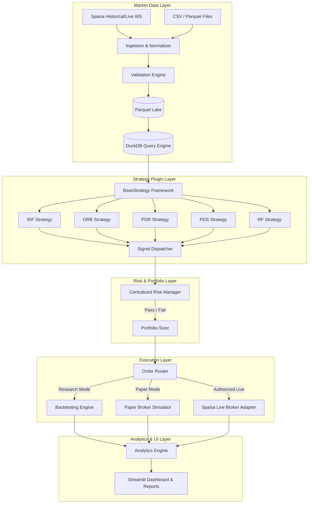

# System Architecture: Multi-Strategy Quantitative Trading Platform

## 1. High-Level Architectural Vision

The platform is designed as an institutional-grade, modular, event-driven quantitative trading and research engine tailored for Indian financial markets (specifically NSE cash/index and derivative instruments via 5paisa). It prioritizes:
1. **Mathematical correctness and determinism**: Candle-by-candle simulation eliminating lookahead bias.
2. **Decoupled layers**: Clean separation between Market Data, Strategy Signal Generation, Risk Management, Order Execution, and Analytics.
3. **Research-to-Live fidelity**: Identical signal generation logic across historical backtests, real-time paper trading, and authorized live execution.
4. **Safety and Fail-safes**: Default research/paper modes, hardware kill-switches, idempotent order dispatch, and multi-layer risk controls.

---

## 2. Component Subsystems

### 2.1 Core Subsystem (`src/trading_platform/core/`)
- `enums.py`: Strongly typed enumeration types for Strategy Names, Entry Methods, Order Types, Sides, Trade Status, Operational Modes, and Data Sources.
- `models.py`: Immutable Pydantic models for Bar, Tick, Signal, Order, Fill, Position, and Trade.
- `events.py`: Domain events facilitating event-driven simulation.
- `clock.py`: Market session clock enforcing Indian Standard Time (`Asia/Kolkata`) and exchange business hours (09:15 to 15:30 IST).
- `exceptions.py`: Domain-specific exceptions ensuring safe handling of risk violations, data corruption, and broker disconnections.

### 2.2 Market Data Subsystem (`src/trading_platform/data/`)
- `providers/`: Extensible provider interface (`BaseDataProvider`) with implementations for `CSVDataProvider` and `FivePaisaDataProvider`.
- `instruments.py`: Rich representation of cash spot index (NIFTY 50), Futures contracts, and Options contracts (CE/PE, strike, expiry, lot size).
- `validation.py`: Rigorous anomaly detection: missing candles, out-of-order timestamps, duplicate bars, inverted OHLC ($High < Low$), and session gap checks.
- `storage.py`: Partitioned columnar Parquet storage with Zstandard (ZSTD) compression and in-process DuckDB relational query engine.
- `calendar.py`: Official NSE trading calendar handling national holidays, special sessions (e.g., Muhurat trading), and daily market schedules.

### 2.3 Strategy Subsystem (`src/trading_platform/strategies/`)
- `base.py`: The `BaseStrategy` interface enforcing lifecycle hooks:
  - `prepare(data, config)`
  - `on_bar(context, bar)`
  - `generate_signal(context)`
  - `validate_signal(signal, context)`
- `registry.py`: Central registration and discovery system for strategies and entry methods.
- `price_action.py`: Standardized mathematical calculations for candle bodies, wicks, pin-bars, swing fractals, and support/resistance zones.

### 2.4 Backtesting Subsystem (`src/trading_platform/backtesting/`)
- Event-driven chronologically sequential candle simulation.
- Realistic transaction cost models (brokerage, STT, exchange turnover fees, GST, SEBI charges, stamp duty).
- Conservative slippage models and explicit handling of intrabar high/low sequence uncertainty.

### 2.5 Broker Adapter Subsystem (`src/trading_platform/brokers/`)
- `base.py`: Standardized broker interface with built-in permission safeguards.
- `paper_broker.py`: High-fidelity in-memory simulated order book and matching engine.
- `fivepaisa.py`: 5paisa REST and WebSocket integration conforming strictly to documented broker capabilities.

### 2.6 Centralized Risk Management (`src/trading_platform/execution/risk_manager.py`)
- Independent from strategies.
- Controls: Max risk per trade, max daily drawdown, max open positions, no-trade blackout windows, automatic EOD square-off (15:15 IST), and emergency kill switch.
