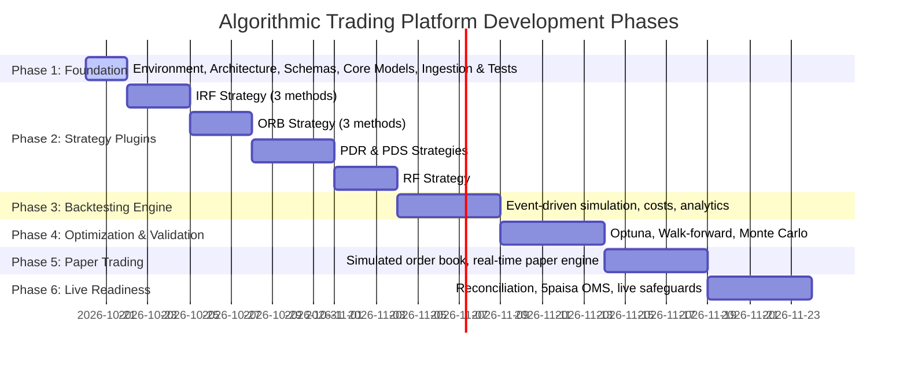

# Master Implementation Plan & Roadmap

## 1. Project Overview & Multi-Phase Roadmap

This roadmap governs the disciplined, staged development of the multi-strategy quantitative research and execution platform for Indian markets (NSE / 5paisa). 

---

## 2. Detailed Phase Breakdown

### Phase 1: Foundation (CURRENT AUTHORIZED PHASE)
- [x] Inspect existing workspace and environment.
- [x] Extract and thoroughly read all 5 Strategy Rulebook PDFs (`IRF`, `ORB`, `PDR`, `PDS`, `RF`).
- [x] Create strategy specification inventory (`docs/strategy_specs/*.md`).
- [x] Document strategy ambiguities and discrepancies (`docs/strategy_ambiguities.md`).
- [x] Configure Python 3.11 virtual environment and install verified, compatible dependencies.
- [x] Establish standard project packaging (`pyproject.toml`, `README.md`, `.gitignore`, `.env.example`).
- [x] Build core domain models, enums, clock, events, and exceptions (`src/trading_platform/core/`).
- [x] Implement Market Data contract, validation, storage (DuckDB + Parquet), and CSV provider.
- [x] Implement Strategy Base class, Lifecycle hooks, and Registry (`src/trading_platform/strategies/`).
- [x] Implement Broker Base interface and PaperBroker adapter with live order placement safeguards.
- [x] Build and run comprehensive unit tests and sample data ingestion pipeline.
- [x] Deliver Phase 1 report and await explicit authorization for Phase 2.

### Phase 2: Strategy Implementation
*Priority Sequence:*
1. **IRF (Initial Range Failure):**
   - Method 1: Breakout & immediate 1-bar failure.
   - Method 2: Extended move and support/resistance break.
   - Method 3: Liquidity sweep with compulsory support break.
2. **ORB (Opening Range Breakout):**
   - Method 1: Previous-day level breakout (PDH / PDL).
   - Method 2: Inner level breakout with trendline.
   - Method 3: 200 DMA / EMA gap setup.
3. **PDR (Previous Day Resistance):**
   - Gap-up open gatekeeper.
   - Zone retest & bullish green candle confirmation.
4. **PDS (Previous Day Support):**
   - Gap-down open gatekeeper.
   - Support-turned-resistance retest.
   - Methods 1, 2, and 3 (good red candle, HPR pin bar, small support break).
5. **RF (Reverse Failure):**
   - Uptrend filter (above 200 EMA).
   - Gap-up within yesterday's range.
   - Breakdown below first 5-min range and reclaim.

### Phase 3: Backtesting & Execution Engine
- Deterministic event-driven candle-by-candle simulation.
- Execution realism: Next-bar open fill, worst-case same-bar SL priority.
- Realistic Indian market transaction costs (STT, exchange turnover, GST, stamp duty, SEBI fees).
- Detailed trade journals, equity curves, drawdown analysis, and QuantStats performance reports.

### Phase 4: Optimization & Robustness Testing
- Optuna Bayesian / TPE hyperparameter optimization.
- Walk-forward train/validation splits with untouchable out-of-sample test datasets.
- Monte Carlo trade-order reshuffling and bootstrap confidence bounds.
- Parameter sensitivity and plateau stability analysis.

### Phase 5: Paper Trading
- Dedicated `PaperBroker` executing on live market data ticks/candles.
- Virtual account ledger, margin calculation, and P&L tracking.
- Streamlit Paper Trading monitoring dashboard.

### Phase 6: Live Readiness & Risk Integration
- Full 5paisa REST & WebSocket adapter.
- Idempotent client order IDs, order reconciliation, and stale data guardrails.
- Emergency kill-switch and centralized risk manager.
- **Formal User Approval Gate:** No live orders can be dispatched without explicit manual approval.
