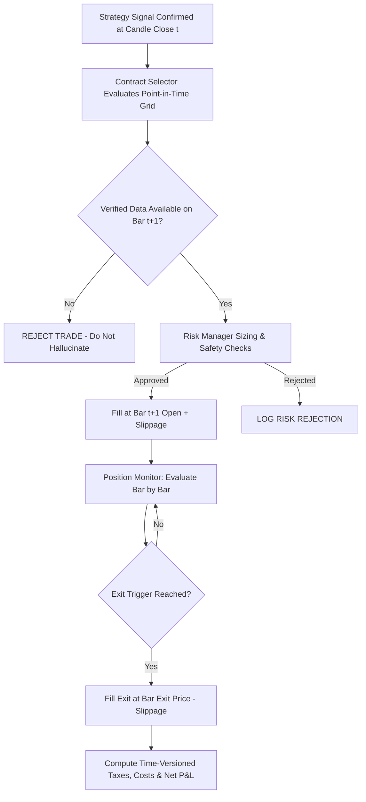

# Options Execution & Simulation Methodology

## 1. Core Principles of Execution Realism

Options backtesting faces severe execution distortions if modeled naively. This platform enforces realistic institutional assumptions tailored specifically for Indian index options.

---

## 2. Order Execution Timeline & Anti-Lookahead

1. **No Bar-Close Execution:**
   - When a 5-minute NIFTY candle closes (e.g., at 09:20:00 IST) and confirms a strategy signal, that closing price is an outcome of the bar that has concluded.
   - Simulated entry occurs strictly on the **Open price of the subsequent bar ($t+1$)**, plus slippage:
     $$\text{Fill Price}_{\text{BUY}} = Open_{t+1} + \text{Slippage}$$
   - If Level-2 bid/ask quote data exists in the feed, execution fills at the actual **Best Ask price**.
2. **Missing Price Invariant:**
   - If historical options data has no candle for the selected strike at $t+1$, the trade is **REJECTED_MISSING_PRICE**. The platform **never invents synthetic prices or uses unrelated strikes**.

---

## 3. Dynamic Strike Selection (Point-in-Time Grid)

Rather than assuming a universal 50-point strike interval:
- The `ContractSelector` reads the **actual available strikes** present on the trading date.
- It determines the At-The-Money (ATM) strike by minimizing $|k - S_{spot}|$.
- **ITM 1 / OTM 1:**
  - For Call (CE): ITM 1 is the next lower strike in the grid; OTM 1 is the next higher strike.
  - For Put (PE): ITM 1 is the next higher strike in the grid; OTM 1 is the next lower strike.
- Expiry policies enforce:
  - `NEAREST_ELIGIBLE`: Expiry date with $DTE \ge \text{min\_dte}$.
  - `allow_expiry_day = false`: Strictly excludes same-day expiring contracts ($DTE = 0$) to protect against extreme gamma decay.

---

## 4. The Three Exit Systems

1. **Underlying-Based Exit (`UNDERLYING_BASED`):**
   - The trade monitors the underlying NIFTY 50 index price action against the original strategy's rules (e.g. 60 pt target, 35 pt stop-loss).
   - When NIFTY hits the target or stop-loss, the option position is exited at its prevailing market price.
   - *Key Realism Insight:* Do **not** assume an index stop-loss implies a fixed rupee loss on the option. Option delta is dynamic and non-linear.
2. **Premium-Based Exit (`PREMIUM_BASED`):**
   - Exits are governed by percentage targets on the entry option premium (e.g., Target: $+50\%$, Stop-Loss: $-25\%$).
   - Exits at the specific premium limit price.
3. **Hybrid Exit (`HYBRID`):**
   - The position exits whenever the *first* valid trigger (underlying target/stop or premium target/stop) is reached.
4. **Conservative Same-Bar Conflict Rule:**
   - If a candle's price range encompasses both Target and Stop-Loss within the same bar, the simulator **always assumes the Stop-Loss was touched first**. Favorable target fills are never assumed on ambiguous bars.
