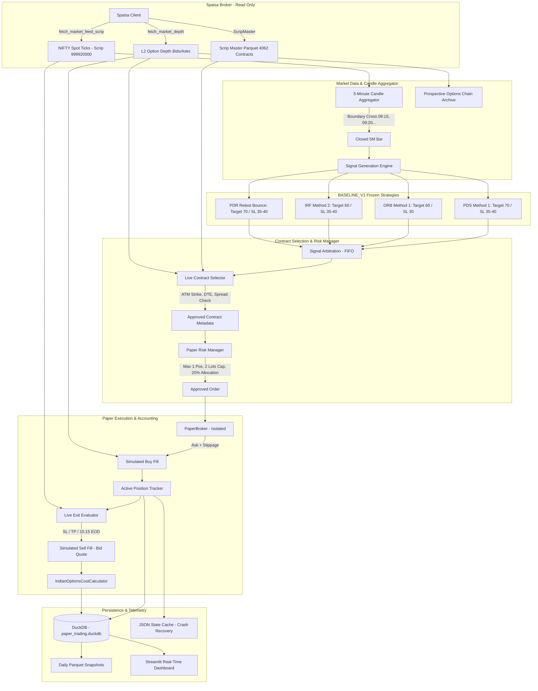

# Phase 4 — Live Market Data & NIFTY Options Paper Trading Architecture

## Executive Summary

Phase 4 implements a persistent, institutional-grade, strictly paper-only NIFTY options trading platform using authenticated live market data from 5paisa. The engine enforces complete isolation between market-data ingestion and virtual execution, guaranteeing that real broker order endpoints can **never** be invoked.

All strategy rules, entry conditions, and stop-loss/target parameters strictly adhere to the frozen **`BASELINE_V1`** benchmark established in Phase 3A:
- **Active Strategies:**
  - Previous Day Support (PDS Method 1): Gap-down setup, rejection of previous day support.
  - Opening Range Breakout (ORB Method 1): Breakout of opening range with canonical trend filters.
  - Initial Range Failure (IRF Method 2): Extension and failure/reversal back through range.
  - Previous Day Resistance (PDR Retest Bounce): Gap-up setup, retest of previous day resistance acting as support.
- **Strictly Excluded:** Resistance Failure (RF), pending approved canonical exit rules.
- **Strategy Freezing:** Zero parameter optimization is permitted during paper trading.
- **Portfolio & Risk Sizing:**
  - Starting virtual capital: ₹250,000.
  - Dynamic affordable lot sizing: up to 2 lots maximum ceiling, restricted by a 20% open premium allocation cap (₹50,000).
  - Maximum concurrent positions: 1.
  - Daily virtual loss limit: 2.0% (₹5,000).
  - Entry cutoff: 14:30 IST; Forced square-off: 15:15 IST.
  - Quote staleness limit: 5 seconds; Spread threshold: 2.0%.

---

## 1. System Architecture & Component Diagram

---

## 2. Safety Architecture & Isolation Guarantees

### Strict Broker Isolation
1. **Dedicated `PaperBroker`:**
   - Operating mode is hard-coded to `OperationalMode.PAPER` with `live_approved = False`.
   - The method `assert_live_allowed()` unconditionally raises `LiveTradingPermissionError`.
   - The broker does not inherit or pass through any order execution client from `py5paisa`.
2. **Read-Only Data Provider:**
   - `FivePaisaBroker` is restricted strictly to market-data endpoints (`fetch_market_feed_scrip`, `fetch_market_depth`, `get_scrip_master`, `fetch_historical_candles`).
   - Order-placement endpoints (`place_order`, `modify_order`, `cancel_order`) on `FivePaisaBroker` explicitly raise `LiveTradingPermissionError`.
3. **Automated Safety Test Gate:**
   - 14 automated deterministic tests verify that any attempt to submit an order through live endpoints immediately halts execution.
4. **Credential Masking:**
   - Application logs, run manifests, and Streamlit dashboards sanitize all authentication tokens, TOTP secrets, user keys, and passwords.

---

## 3. Market Data Ingestion & Candle Building

### Protocol & Endpoints
- **Spot Ticker:** Polled via 5paisa `fetch_market_feed_scrip` for canonical ScripCode `999920000` (NIFTY 50 cash index). Returns `LastRate`, `High`, `Low`, `PClose`, `TickDt`, and `TimeStamp`.
- **Level 2 Market Depth:** Polled via 5paisa `fetch_market_depth` using `Exchange="N"`, `ExchangeType="D"`, `ScripCode=<token>`. Returns top 5 bids and asks with exact order counts and quantities.

### Timestamp Handling & Staleness Filtering
- **Dual Timestamps:** Every event stores both the exchange provider timestamp (`TickDt` converted to Asia/Kolkata) and local system ingestion timestamp (`datetime.now(UTC)`).
- **Quote Staleness Limit:** Quotes with age $> 30.0$ seconds are flagged `is_stale = True`. New entries on stale quotes are strictly rejected (`REJECTED_STALE_QUOTE`).

### Session Boundary Candle Aggregation
- Aligned strictly to NSE trading sessions (09:15 to 15:30 IST):
  - 09:15–09:20, 09:20–09:25, ..., 15:20–15:25, 15:25–15:30.
- **Signal Invariant:** Strategy evaluation occurs **only after** a 5-minute candle has officially closed (triggered when the first tick crossing the 5-minute boundary arrives).

---

## 4. Contract Selection & Validation Rules

When a canonical strategy emits a signal:
1. **Directional Mapping:**
   - Bullish Signal (BUY) $\rightarrow$ Call Option (**CE**)
   - Bearish Signal (SELL) $\rightarrow$ Put Option (**PE**)
2. **Dynamic ATM Strike Selection:**
   - Spot price rounded to nearest 50 points: $\text{Strike} = \text{round}(S / 50.0) \times 50.0$.
3. **Expiry & DTE Validation:**
   - Filter active NIFTY options from `scrip_master.parquet`.
   - Select nearest active weekly expiry ($\text{DTE} \ge 0$).
4. **Dynamic Lot Sizing:**
   - Read directly from `contract.lot_size` in official metadata (e.g., 65 for October 2026 weekly options). Hardcoding lot sizes is strictly prohibited.
5. **Level 2 Quote Depth Validation:**
   - `best_ask > 0` (for buy entry) and `best_bid > 0` (for sell exit).
   - Reject crossed order books (`best_bid > best_ask`).
   - Reject wide spreads: $\text{Spread} \le 5.0$ points and $\text{Spread} / \text{Ask} \le 5.0\%$.

---

## 5. Order Simulation & Statutory Cost Modeling

### Realistic Quote Matching
- **Simulated Buy (Entry):** Filled at `best_ask + slippage` ($0.50$ pts conservative slippage).
- **Simulated Sell (Exit):** Filled at `best_bid - slippage` ($0.50$ pts conservative slippage).
- Last traded price (LTP) is **never** assumed to be executable. If quotes are absent, `NO_EXECUTABLE_QUOTE` is logged and execution is skipped.

### Date-Versioned Statutory Taxes & Costs
Implemented in `IndianOptionsCostCalculator` adhering to regulatory schedules:
1. **Brokerage (5paisa):** Flat ₹20 per executed order leg (₹40 round-trip).
2. **Securities Transaction Tax (STT):**
   - 0.1000% on sell-side premium value (Oct 1, 2024 to Mar 31, 2026).
   - 0.1500% on sell-side premium value (Apr 1, 2026 onwards).
3. **Exchange Transaction Charges (NSE):**
   - 0.03503% (₹35.03 per lakh) flat rate effective Oct 1, 2024 (SEBI true-to-label circular).
4. **Stamp Duty:** 0.003% on buy-side premium value only.
5. **SEBI Turnover Fee:** ₹10 per crore (0.0001%) on both buy and sell.
6. **GST:** 18% on (Brokerage + Exchange Charges + SEBI Fees).

---

## 6. Strategy Exit Rules & Dual Accounting

### Underlying-Based Exit Trigger
Exit decisions are monitored against live NIFTY 50 spot ticks:
- **Stop-Loss Hit:** Spot crosses stop-loss level.
- **Target Hit:** Spot crosses profit target level.
- **Intraday Square-Off:** System clock reaches 15:15 IST.
- **Kill Switch:** Manual or programmatic kill switch activation.

### Dual Ledger Attribution
Every completed trade stores two independent accounting results:
1. **Underlying Result (NIFTY Index Points):**
   $$\text{Points PnL} = (\text{Exit Spot} - \text{Entry Spot}) \times \text{Direction}$$
2. **Simulated Option Result (INR):**
   $$\text{Gross PnL} = (\text{Exit Premium} - \text{Entry Premium}) \times \text{Quantity}$$
   $$\text{Net PnL} = \text{Gross PnL} - \text{Total Statutory Costs & Brokerage}$$

---

## 7. Portfolio Risk Controls & Crash Recovery

| Control Parameter | Configured Value | Enforcement Mechanism |
|---|---|---|
| **Max Concurrent Positions** | 1 | `PaperRiskManager` + Engine State Lock |
| **Max Order Size** | 2 NIFTY Lots | Dynamic affordable lot sizing (1 or 2 lots based on premium) |
| **Open Premium Allocation Cap**| 20.0% of Capital (₹50,000) | `VirtualPortfolio.validate_capital_and_allocation()` |
| **Starting Virtual Capital** | ₹250,000 | `PaperBroker` & `VirtualPortfolio` cash ledger |
| **Max Daily Virtual Loss** | 2.0% (₹5,000) | Trading halts for the day upon breach |
| **Entry Cutoff Time** | 14:30 IST | Blocks new signals past cutoff |
| **Forced Square-Off Time** | 15:15 IST | Closes active position at live market bid |
| **Max Spread Points / Pct** | 2.0% | Rejects contract selection if exceeded |
| **Quote Staleness Limit** | 5.0 seconds | Rejects contract selection if exceeded |
| **Restart Recovery** | Enabled | Dual-layer persistence (`duckdb` + JSON) |

### Crash & Restart Resilience
- State is serialized immediately to `data/cache/paper_engine_state.json` and `paper_broker_state.json` upon every order and position change.
- On reboot, the engine reloads open positions, cash balances, and risk counters. Position duplication is physically impossible.

---

## 8. Persistence Architecture (DuckDB + Parquet)

- **Analytical Database:** `data/processed/paper_trading.duckdb`
- **Tables Captured:**
  1. `market_events`: Raw spot ticks, provider & ingestion timestamps.
  2. `candles_1m` & `candles_5m`: Completed 1-minute and 5-minute OHLCV candles.
  3. `options_archive`: Prospective option chain Level 2 bids, asks, quantities, LTP, OI, freshness.
  4. `signals`: Generated strategy signals with rule IDs.
  5. `contract_selections`: Option selection decisions and rejection reasons.
  6. `virtual_orders`: Virtual order dispatches and lifecycle states.
  7. `virtual_fills`: Execution prices, slippage, and fee breakdowns.
  8. `completed_trades`: Dual-ledger trade results and exit reasons.
  9. `equity_snapshots`: Available cash, invested capital, MTM equity, and drawdown.
- **Daily Parquet Export:** Automated export to `reports/paper_trading/*.parquet` with ZSTD compression and prospective option chains partitioned by date in `data/processed/options_archive/date=YYYY-MM-DD/`.
