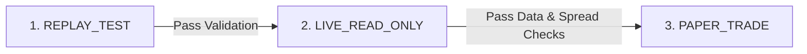

# Phase 4 — Paper Trading Platform Operator Runbook

## Overview

This runbook provides exact, deterministic commands to initialize, monitor, validate, and operate the persistent NIFTY options paper trading platform.

> [!CAUTION]
> **STRICT SAFETY NOTICE:**
> The platform operates strictly in virtual simulation mode. Real money or broker order endpoints can **never** be invoked.
> Do **NOT** claim unattended monitoring is active after the local terminal process exits.

---

## 1. Operating Modes & Phased Launch Workflow

The platform implements three sequential operating modes:



1. **`REPLAY_TEST` (Deterministic Baseline Verification):**
   - Uses historical 5-minute bars and simulated Level 2 quote depth.
   - Tests order creation, fill calculation, statutory cost breakdown, position management, and persistence without making network calls.
2. **`LIVE_READ_ONLY` (Authenticated Feed Monitoring):**
   - Connects to 5paisa using authenticated session tokens.
   - Ingests real-time NIFTY 50 spot ticks and Level 2 option depth.
   - Aggregates live 5-minute candles and evaluates strategy signals.
   - **Places ZERO virtual orders.**
3. **`PAPER_TRADE` (Active Virtual Order Execution):**
   - Executes virtual option buy/sell orders matching against live 5paisa Level 2 ask/bid quotes.
   - Enforces risk controls, EOD square-off at 15:15 IST, and DuckDB persistence.
   - **Must only be activated after REPLAY_TEST and LIVE_READ_ONLY have successfully passed.**

---

## 2. Environment Preparation

Ensure the virtual environment is active and configuration files exist:

```bash
cd /Users/syedaskari/project/5paisa-options

# 1. Activate Python virtual environment
source .venv/bin/activate

# 2. Verify dependencies and database directories
python -c "import py5paisa, duckdb, streamlit, plotly; print('Dependencies verified.')"
mkdir -p data/processed data/cache reports/paper_trading data/processed/options_archive
```

---

## 3. Step-by-Step Operator Workflow

The platform provides a unified CLI via `python -m trading_platform.paper.cli` supporting seven commands:
`doctor`, `replay`, `observe`, `start`, `status`, `report`, `stop`.

### Step 1: Platform & Broker Connectivity Health Check (`doctor`)

Verify Python environment, credentials, cached session token, read-only 5paisa market feed, and safety gatekeepers:

```bash
python -m trading_platform.paper.cli doctor
```

**Expected Terminal Output:**
```text
======================================================================
🩺 5PAISA OPTIONS PLATFORM HEALTH CHECK
======================================================================
1. Python Environment:     OK (Python 3.11+)
2. Configuration File:     OK (config/paper_trading.yaml)
3. 5paisa Credentials:     ClientCode=OK, UserKey=OK, EncryptionKey=OK
4. Cached Session Token:   FOUND
5. Testing Read-Only Market Feed...
   [SUCCESS] Live NIFTY Spot: 22,811.35 | Status: 0 (OK)
6. Safety Gatekeeper:      VERIFIED (Live orders permanently blocked)
======================================================================
```

---

### Step 2: Deterministic Offline Replay Test (`replay`)

Validate strategy signal generation, level 2 quote matching, dual ledger accounting, and persistence without making network calls:

```bash
python -m trading_platform.paper.cli replay --bars 20
```

**Expected Terminal Output:**
```text
======================================================================
🎬 EXECUTING DETERMINISTIC REPLAY TEST
======================================================================
Replayed 20 historical 5-minute candles.

REPLAY SUMMARY:
Total Equity:       ₹250,000.00
Realized P&L:       ₹0.00
Signals Evaluated:  0
Candles Processed:  20
======================================================================
```

---

### Step 3: Live Read-Only Market Observation & Options Archival (`observe`)

Connect to genuine 5paisa data, record spot ticks, build 1m and 5m candles, evaluate strategy signals, and capture prospective ATM option chain Level 2 quotes to DuckDB and date-partitioned Parquet (`data/processed/options_archive/`). **Zero virtual orders are placed.**

```bash
# Monitor 10 real-time cycles (1 second per cycle)
python -m trading_platform.paper.cli observe --cycles 10
```

**Expected Terminal Output:**
```text
======================================================================
📡 STARTING LIVE_READ_ONLY OBSERVATION MODE
======================================================================
Recording live market data for 10 cycles (1s interval)...
[1/10] Spot: 22,811.35 | Time: 15:59:59 | Stale: False
[2/10] Spot: 22,811.35 | Time: 15:59:59 | Stale: False
...
Flushed prospective option chain to: data/processed/options_archive/date=YYYY-MM-DD/options_archive_RUN_...parquet
Observation cycle complete.
```

---

### Step 4: Launch Live Paper Trading Engine (`start`)

Activate simulated option trading during market hours. Requires explicit `--confirm-paper-only` safety flag:

```bash
# Activate paper trading for 300 cycles (5 minutes)
python -m trading_platform.paper.cli start --confirm-paper-only --cycles 300
```

To run continuously during market hours:
```bash
python -m trading_platform.paper.cli start --confirm-paper-only --cycles 999999
```

**Safety Feature:** Omitting `--confirm-paper-only` immediately aborts execution with exit code 1.

---

### Step 5: Virtual Account & Risk Telemetry (`status`)

Inspect the virtual portfolio, available cash, open positions, daily drawdown, and allocation usage:

```bash
python -m trading_platform.paper.cli status
```

**Expected Output:**
```text
======================================================================
📊 VIRTUAL ACCOUNT STATUS
======================================================================
Run ID:               RUN_...
Mode:                 PAPER_TRADE
NIFTY 50 Spot:        22,811.35
Available Cash:       ₹250,000.00
Invested Capital:     ₹0.00
Total Equity:         ₹250,000.00
Realized P&L:         ₹0.00
Unrealized P&L:       ₹0.00
Daily Drawdown:       0.00%
Max Allocation Cap:   ₹50,000.00

Active Position:      NONE (Flat)
Closed Trades Count:  0
======================================================================
```

---

### Step 6: Generate Performance Reports (`report`)

Generate daily trade journals, strategy breakdown tables, and dual ledger comparisons exported to Parquet and CSV:

```bash
python -m trading_platform.paper.cli report
```

---

### Step 7: Emergency Stop & Kill Switch (`stop`)

Cleanly signal the running engine to halt signal acceptance, square off open positions at the prevailing executable bid, and serialize state:

```bash
python -m trading_platform.paper.cli stop
```

---

### Step 8: Launch Interactive Streamlit Dashboard

In a dedicated terminal, launch the real-time Streamlit dashboard:

```bash
streamlit run scripts/paper_trading_dashboard.py --server.port 8501
```

The dashboard opens at `http://localhost:8501` featuring:
- **PAPER TRADING ONLY — ZERO REAL BROKER ORDERS** prominent banner.
- Real-time NIFTY spot ticker, available virtual cash (₹250,000), and daily drawdown.
- Active option position details (contract, strike, expiry, lots, entry premium, live P&L).
- Live 5-minute candlestick chart with entry, target, and stop-loss overlays.
- Generated signals and contract selection audit logs.
- Dual-ledger completed trades table comparing index points vs option rupees.

Alternatively, create the kill-switch flag file manually:
```bash
touch data/cache/kill_switch.flag
```

**Actions Performed by Kill Switch:**
1. Instantly halts acceptance of new strategy signals.
2. If a virtual position is open, simulates an immediate market sell at the prevailing Level 2 Bid quote.
3. Records `exit_reason = "KILL_SWITCH"` in the trade journal and DuckDB.
4. Serializes state to disk.

---

## 5. Inspecting DuckDB Analytics & Audit Records

Query the analytical database directly using Python or the DuckDB CLI:

```bash
python -c "
import duckdb
con = duckdb.connect('data/processed/paper_trading.duckdb')
print('=== COMPLETED TRADES ===')
print(con.execute('SELECT trade_id, strategy_name, symbol, underlying_points_pnl, option_net_pnl, exit_reason FROM completed_trades').df())
print('\n=== LATEST EQUITY SNAPSHOTS ===')
print(con.execute('SELECT timestamp, available_cash, total_equity, daily_drawdown FROM equity_snapshots ORDER BY timestamp DESC LIMIT 5').df())
con.close()
"
```

---

## 6. Daily Shutdown & Report Archival

At the end of the trading session (after 15:30 IST):

1. **Stop the Monitoring Process:** Press `Ctrl+C` in the terminal running the paper trading engine.
2. **Export Parquet Reports:**
   ```bash
   python scripts/run_paper_trading.py --mode REPLAY_TEST --export-reports
   ```
3. **Verify Report Files:**
   ```bash
   ls -la reports/paper_trading/
   ```
4. **Inspect State Integrity:** Verify that `data/cache/paper_engine_state.json` has `active_position: null` following the 15:15 IST forced square-off.
